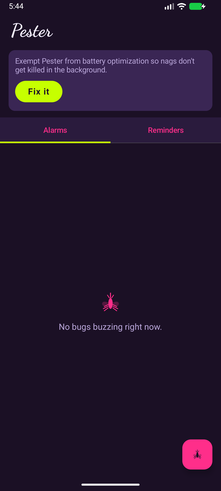
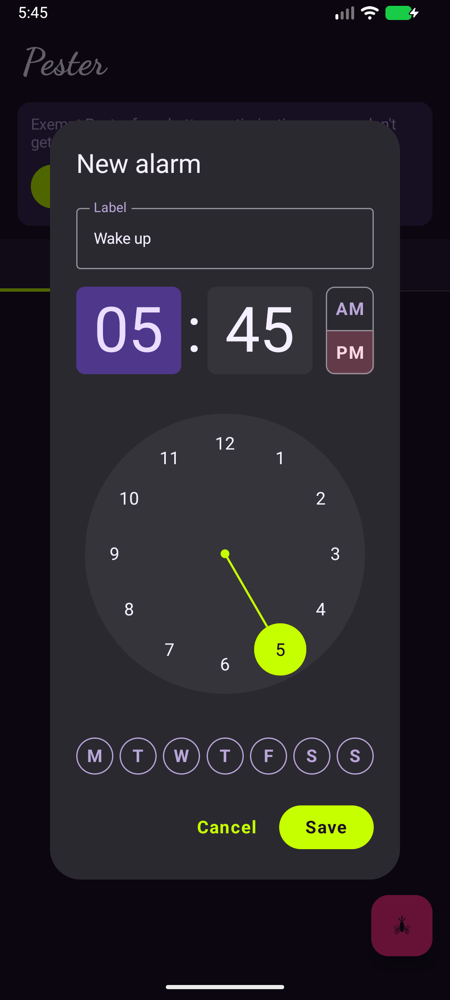
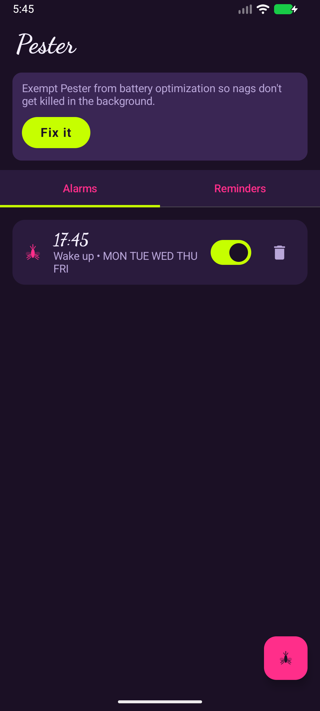
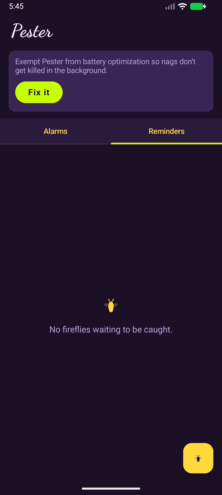
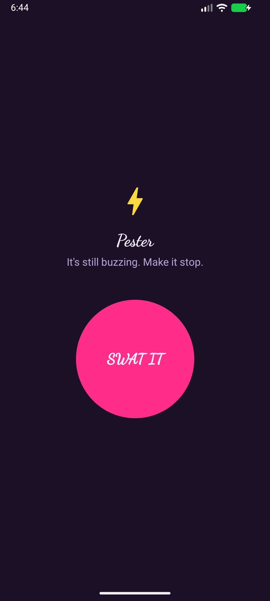

# 🦟 Pester

An alarm/reminder app that refuses to be dismissed from across the room.

## Why

A normal reminder pings you once. You swipe it away — on purpose or by
reflex — and now the task feels *more* done than before, because your brain
filed the notification as "handled." Pester keeps nagging, every 30 seconds,
until you open the app and confirm the task is actually finished. No snooze.

Use cases:
- "Move the laundry to the dryer" — said out loud, immediately forgotten.
- Something's defrosting and needs to hit the oven by 5:30.
- Bring the trash cans in before you leave for work.
- Take your meds with lunch.
- A kitchen timer you'd otherwise half-hear and ignore.
- Wake up (see below) and actually get up.

Two front ends, one nag engine: **Reminders** (one-shot) and **Alarms**
(recurring, day-of-week).

## How this idea came about

I use a Garmin watch as my alarm because its vibration is quiet enough not
to wake the household — but that also makes it trivial to dismiss half
asleep. A loud phone alarm in another room wasn't an option either, since
anything loud enough to hear from elsewhere would wake everyone else.

Turns out smartwatches buzz for *any* mirrored phone notification,
regardless of whether the phone itself makes a sound. So the phone doesn't
need to ring at all — it can sit silently in another room and just keep
re-posting a notification. The watch buzzes every cycle; the phone never
does; the only way to stop it is to walk over and deal with it. That's a
general "keep nagging until I actually handle this" engine, not just an
alarm clock — the Garmin angle is one use case now, not the whole app (see
[Testing against a real Garmin](#testing-against-a-real-garmin)).

## Design

Dusk/bug-zapper theme: purple-black background, acid-green and hot-pink
neon accents, a comic-style "BZZZT!" payoff on dismiss. Mosquito mascot for
Alarms (the one you swat), firefly for Reminders (the one you catch).

## Screenshots

| Alarms | New alarm | Alarms set |
|---|---|---|
|  |  |  |

| Reminders | Dismiss screen |
|---|---|
|  |  |

## Getting it running

1. Open in Android Studio, let Gradle sync.
2. Run on a **physical device** paired with your watch — an emulator can't
   test real Bluetooth notification mirroring.
3. Grant the notification, exact-alarm, and battery-optimization prompts.
4. In your watch's companion app, make sure Pester isn't excluded from
   notification mirroring.

Or grab the latest APK from [Releases](../../releases) and sideload it.

## Testing against a real Garmin

1. Pair the watch with the phone via Garmin Connect, if not already.
2. In Garmin Connect's notification settings, confirm Pester isn't
   excluded, and that the watch's own Do Not Disturb isn't active.
3. Put the phone on silent (Pester's channels ship silent by default).
4. Create an Alarm or Reminder a couple of minutes out, leave the phone in
   another room.
5. Expect: phone makes zero sound/vibration; watch buzzes every ~30s.
6. Walk over, open Pester, hit **SWAT IT** — watch stops immediately.
7. No buzzing at all? Recheck step 2 first — a Garmin-side exclusion or
   active DND is the usual cause, not an app bug.

## Architecture

- `data/` — Room entity/DAO for the shared `Nag` model.
- `alarm/` — `AlarmManager` scheduling, trigger receiver, boot persistence.
- `nag/` — the foreground service looping the silent notification, and the
  full-screen `DismissActivity`.
- `ui/` — Compose UI: tabs, add/edit dialog, theme.

## License

Personal project, no license granted.
